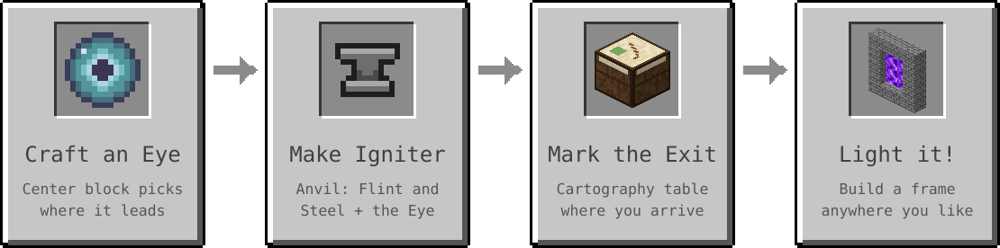
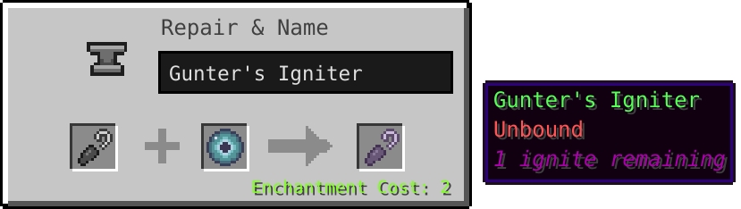
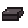
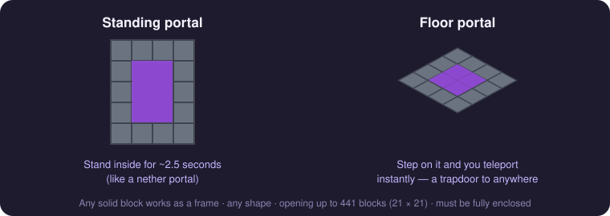

# Paper Portals

**Build your own portals in survival, and send them anywhere you like.**

Paper Portals is a plugin for [Paper](https://papermc.io/) Minecraft servers that lets players
build their own portals in survival. Choose a destination anywhere in the Overworld, Nether or End,
then build portals that take you straight there from any dimension. There are no coordinates to
calculate, and vanilla nether portals keep working as normal.

<p align="center">
  
</p>

---

## Contents

- [How it works](#how-it-works)
- [Example: a portal home from the Nether](#example-a-portal-home-from-the-nether)
- [Step-by-step guide](#step-by-step-guide)
  - [1. Craft an Eye of Rhumb](#1-craft-an-eye-of-rhumb)
  - [2. Make a Gunter's Igniter](#2-make-a-gunters-igniter)
  - [3. Upgrade it (optional, but only now)](#3-upgrade-it-optional-but-only-now)
  - [4. Mark the destination](#4-mark-the-destination)
  - [5. Build a frame and light it](#5-build-a-frame-and-light-it)
- [FAQ](#faq)
- [For server admins](#for-server-admins)
- [For contributors](#for-contributors)

---

## How it works

Think of the **igniter** as a key to one place. First you choose the place, then you build portals
that lead there.

1. **Craft an Eye of Rhumb.** Eight Eyes of Ender around a grass block, netherrack or end stone. The
   center block picks the **dimension your portal will lead to**: Overworld, Nether or End.
2. **Make an igniter.** At an anvil, combine Flint and Steel with the Eye. Now you have an igniter for
   that dimension.
3. **Mark the destination.** Go to the exact spot where you want people to **come out**. Place a
   cartography table there and right-click it with the igniter. The igniter now remembers that spot.
4. **Light a portal.** Build a frame **anywhere, in any dimension**. Right-click inside it with the
   igniter. Everyone who walks in comes out at the spot you marked.

### Before you start

> [!IMPORTANT]
> - **Portals are one-way.** A portal sends you to the marked spot, but nothing brings you back. For
>   a round trip, make **two igniters** and build a portal at each end.
> - **A basic igniter lights only one portal**, then it breaks. Add a diamond (10 portals) or
>   netherite (50 portals) at the anvil to add durability.
> - **Upgrade before you mark the destination.** Once an igniter has a destination it can't be
>   changed or upgraded.
> - **Mark the destination in the right dimension.** A Nether igniter only works on a cartography
>   table in the Nether, and so on.
> - **Portals last until the frame is broken.** Using up or losing the igniter doesn't affect
>   portals it already lit.

---

## Example: a portal home from the Nether

You have a base in the Overworld and you're exploring the Nether. You want a quick way home.

1. Craft an **Overworld Eye of Rhumb** (8 Eyes of Ender + grass block), because home is in the
   Overworld.
2. At an anvil, combine **Flint and Steel + the Overworld Eye**. Add a diamond too if you want to
   build more than one portal home.
3. At your base, place a **cartography table** where you want to arrive and right-click it with the
   igniter. The table disappears in a flash of lightning.
4. In the Nether, build a frame and **right-click inside it** with the igniter. Step in and you're
   home.

To also travel *back* to the Nether, repeat the steps with a **Nether** Eye: mark a spot in the
Nether, then light a second portal at your base.

---

## Step-by-step guide

### 1. Craft an Eye of Rhumb

**Where:** any crafting table.

Put **eight Eyes of Ender** around a center block. The center block decides which dimension your
portals will lead **to**:

<p align="center">
  
</p>

|   | Center block | You get                  | Portals will lead to… |
| - | ------------ | ------------------------ | --------------------- |
|  | Grass Block  | Overworld Eye of Rhumb   | the Overworld         |
|  | Netherrack   | Nether Eye of Rhumb      | the Nether            |
|  | End Stone    | Eye of Rhumb's End       | the End               |

### 2. Make a Gunter's Igniter

**Where:** an anvil. **Cost:** 2 levels.

Put a **Flint and Steel** in the left slot and your **Eye of Rhumb** in the right slot. You get a
glowing *Gunter's Igniter* for that dimension. You can rename it while you're at the anvil.

<p align="center">
  
</p>

Its tooltip says **Unbound**, which means it has no destination yet, and **1 ignite remaining**.

### 3. Upgrade it (optional, but only now)

**Where:** an anvil.

Put the igniter in the left slot and one of these in the right slot:

|   | Add…              | What it does                                           | Cost      |
| - | ----------------- | ------------------------------------------------------ | --------- |
|  | Diamond           | Lights **10** portals instead of 1                     | 5 levels  |
|  | Netherite Ingot   | Lights **50** portals (works after a diamond, too)     | 15 levels |
|  | Any dye           | Tints the portal (add several for a multi-hued portal) | 2 levels  |
|  | Block of Redstone | Makes the portal redstone-controlled *(experimental)*  | 10 levels |

> [!WARNING]
> Upgrades only work while the igniter is still **Unbound**. Once you mark a destination in the next
> step, the igniter can't be upgraded any more.

### 4. Mark the destination

**Where:** the exact spot where you want to **come out** of your portals. It must be in the igniter's
dimension.


Place a **Cartography Table** and **right-click it with the igniter**. Lightning strikes ⚡, the table
is used up, and the igniter's tooltip now shows the coordinates it's tied to.

This is permanent. An igniter can never be pointed at a different spot.

### 5. Build a frame and light it

**Where:** anywhere, in any dimension. This is where you'll step **in**.

Build a closed frame out of **any solid blocks**. It can be any shape, as long as the opening is
fully enclosed and no bigger than 441 blocks (21 × 21). **Right-click the inside edge of the frame**
with the igniter and the opening fills with a portal.

<p align="center">
  
</p>

- **Standing portals** (upright) work like a nether portal: stand in one for about 2.5 seconds.
- **Floor portals** (flat) teleport you **instantly** when you step on them. Great for trapdoor drops!
- Creative and spectator players always teleport instantly, and don't use up igniter charges.

Each portal you light uses one charge. When the last one is used, the igniter breaks. The portals it
made keep working.

---

## FAQ

**Can one igniter make several portals?**
Yes, if you upgraded it with a diamond or netherite. Every portal it lights goes to the same spot, so
you can have many entrances leading to one destination.

**How do I get back?**
Portals are one-way. Make a second igniter, mark a spot near your first portal, and light a portal at
the far end.

**Can I change where a portal goes?**
No. Break the frame to remove the portal, then light a new one with a different igniter.

**Will I land inside a wall?**
It shouldn't. The plugin checks that the landing spot is safe before teleporting you.

**Does it interfere with vanilla nether portals?**
No. Vanilla nether portals won't link into or overwrite custom portals.

---

## For server admins

### Installing

1. Download the latest `PaperPortals-*.jar` from the [Releases](../../releases) page, or
   [build it yourself](#building).
2. Drop it in your server's `plugins/` folder.
3. Restart the server. Paper downloads the protobuf library the plugin needs automatically.

**Requirements:** Java 25 and a Paper server that matches the release you download. Each release
is named for its Paper version (for example *PaperPortals for 26.3*).

### Commands

All commands need the `portpower.command.use` permission (ops have it by default).

| Command                                 | What it does                                               |
| --------------------------------------- | ---------------------------------------------------------- |
| `/portpower gettool <world> <player>`   | Gives a player a ready-made igniter, skipping the crafting steps. `<world>` is `overworld`, `the_nether` or `the_end`. |
| `/portpower debugdump`                  | Writes all loaded portal blocks to the server log.         |

### Configuration

`plugins/PaperPortals/config.yml`:

```yaml
# Which block fills a portal. The default, "light", is invisible.
# You can also use "minecraft:nether_portal" for the classic purple swirl.
portal-block-type-list:
  - "minecraft:light"
portal-vertical-block-type: "minecraft:light"    # standing portals
portal-horizontal-block-type: "minecraft:light"  # floor portals

# Anvil XP-level cost for each step
igniter-operation-costs:
  bind-to-eye: 2        # Flint and Steel + Eye of Rhumb
  bind-to-dye: 2
  bind-to-diamond: 5
  bind-to-netherite: 15
  bind-to-redstone: 10
```

---

## For contributors

Contributions are welcome! Here's how to get going.

### Building

You need **JDK 25**. The Gradle wrapper handles everything else.

```bash
git clone https://github.com/dbrandon/PaperPortals.git
cd PaperPortals
./gradlew build
```

The plugin jar ends up in `build/libs/`. Copy it into a local Paper test server's `plugins/` folder
to try it out.

### How the code is organized

Everything lives under `src/main/java/com/tubba/mc/paper/portals/`:

| File / package               | Responsibility                                                       |
| ---------------------------- | -------------------------------------------------------------------- |
| `PortalPowerPlugin`          | Plugin entry point, wiring, and the `/portpower` command             |
| `RhumbEyeManager`            | Eye of Rhumb items and crafting recipes                              |
| `IgniterManager`             | Igniter items: anvil upgrades, lore, uses, binding to a destination  |
| `PortalListener`             | Lighting portals, walking into them, the teleport countdown, anvils |
| `PortalRegistry`             | Stores which blocks are portals and where they lead                  |
| `PortalPhysicsListener`      | Keeps portal blocks from breaking, removes them when the frame breaks |
| `NetherPortalBlockListener`  | Stops vanilla nether portals from linking into custom portals        |
| `PortalSpawnFinder`          | Finds a safe spot to land                                            |
| `scan/`                      | Flood fill that finds the open area inside a frame                   |
| `src/main/proto/`            | Protobuf schema for data stored on items and blocks                  |

Item and block state is stored as protobuf messages in Bukkit's `PersistentDataContainer`. If you
change `portal_data.proto`, add new fields instead of renumbering existing ones, so portals and
igniters already in players' worlds keep working.

### Updating the README graphics

The pictures in `docs/images/` are original pixel art in a Minecraft style, made by
`docs/images/generate.py` (Python 3, no dependencies). They don't use any Mojang textures. To change
one, edit the script and run:

```bash
python3 docs/images/generate.py
```

### Sending a change

1. Fork the repo and create a branch for your change.
2. Test it on a local Paper server.
3. Open a pull request describing what you changed and how you tested it.

### Security

Supported versions are listed in [SECURITY.md](SECURITY.md). If you find a security problem,
please contact the maintainer privately instead of opening a public issue.
